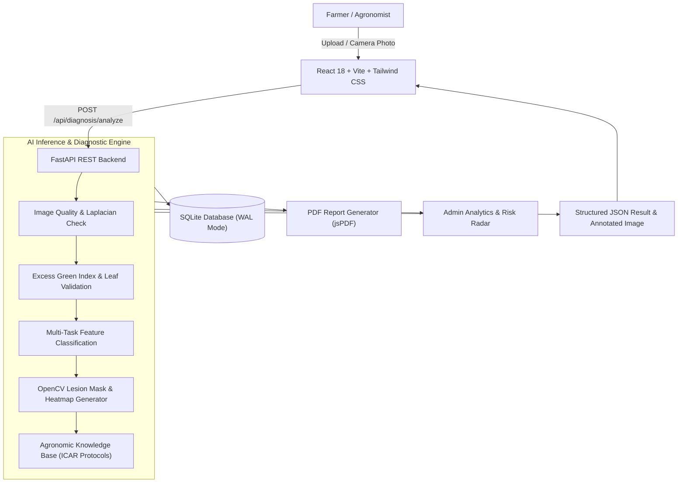

# Intelligent Crop Disease Diagnosis and Management System Using AI

> **A Commercial-Grade, Full-Stack Agriculture Web Platform Powered by AI Computer Vision, Agronomic Knowledge Systems, and Real-Time Pathology Risk Radar.**

---

## 🌾 Overview

The **Intelligent Crop Disease Diagnosis and Management System Using AI** is a modern, responsive web application engineered to empower farmers, agronomists, and agricultural extension officers. It leverages cutting-edge computer vision to diagnose crop diseases from leaf photographs, determine phenological growth stages, calculate lesion severity percentages, and prescribe verified organic and chemical treatment plans following **ICAR (Indian Council of Agricultural Research)** protocols.

### 🌟 Key Highlights
- **AI Multi-Task Diagnosis Pipeline:** Identifies crop species (Tomato, Potato, Rice, Corn, Apple, Grape, etc.), estimates growth stage (Germination to Harvest-ready), classifies foliar pathogens with confidence scores, and computes exact lesion area percentage.
- **Visual Symptom Localization Heatmap:** Generates an annotated symptom overlay highlighting necrotic spots and chlorotic halos with bounding boxes and heat contours.
- **Image Quality & Leaf Safeguard:** Evaluates Laplacian variance and Excess Green (ExG) vegetation index to reject non-leaf or blurred photos, ensuring reliable diagnostic outcomes.
- **Weather-Based Disease Risk Radar:** Correlates real-time microclimate meteorology (temperature, relative humidity, precipitation) with pathogen life cycles to alert farmers up to 48 hours in advance.
- **Bilingual "AgriBot" Assistant:** Interactive AI farming assistant supporting conversational agronomic advice in **English and Tamil**.
- **Crop Health Timeline & Image Comparison:** Track monitored plots over weeks with Recharts vigor trends and earlier vs recent visual comparison sliders.
- **One-Click PDF Diagnosis Reports:** Generates professional multi-page agronomic prescriptions with metadata, image summaries, and safety guidelines.

---

## 🏛️ System Architecture



---

## 🛠️ Tech Stack

| Component | Technology | Description |
| :--- | :--- | :--- |
| **Frontend** | React 18, Vite, Tailwind CSS | High-performance responsive UI with Forest Green theme |
| **Icons & Charts**| Lucide React, Recharts | Attractive icons & interactive health trend charts |
| **Reports** | jsPDF, Canvas Confetti | PDF report generation & UI feedback |
| **Backend** | Python 3.15, FastAPI, Uvicorn | High-throughput async REST API |
| **AI / Vision**| OpenCV (headless), NumPy, PIL | Real-time leaf validation, lesion masking & heatmap overlay |
| **Database** | SQLite3 (WAL Mode) | Zero-setup persistent storage for crops, diagnoses & chat |
| **Weather** | Open-Meteo Meteorology API | Real-time agro-meteorology & risk modeling |

---

## 🚀 Quick Start & Installation

### 1. Prerequisites
- **Node.js** v18+ & **npm**
- **Python** 3.10+ & **pip**

### 2. Backend Setup
```bash
# Navigate to backend directory
cd backend

# Install dependencies
pip install -r ../requirements.txt

# Start the FastAPI server
uvicorn app.main:app --reload --port 8000
```
*The backend API documentation is available at [http://127.0.0.1:8000/docs](http://127.0.0.1:8000/docs).*

### 3. Frontend Setup
```bash
# Navigate to frontend directory
cd frontend

# Install dependencies
npm install

# Start Vite development server
npm run dev
```
*The web interface is accessible at [http://127.0.0.1:5173](http://127.0.0.1:5173).*

---

## 📡 Backend API Endpoints

| Method | Endpoint | Description |
| :--- | :--- | :--- |
| `POST` | `/api/auth/register` | Register new farmer account with acreage & location |
| `POST` | `/api/auth/login` | Authenticate farmer and return session token |
| `GET` | `/api/profile` | Retrieve farmer profile, farm details, and summary stats |
| `POST` | `/api/diagnosis/analyze` | Upload leaf image, execute AI pipeline & return diagnosis |
| `GET` | `/api/diagnosis/history` | Filterable, searchable diagnostic report archive |
| `GET` | `/api/diagnosis/{id}` | Retrieve specific diagnosis report by ID |
| `GET` | `/api/weather` | Current weather, 5-day forecast, and disease risk radar |
| `GET` | `/api/crops` | List all monitored crop field plots |
| `POST` | `/api/crops` | Register new monitored crop field |
| `GET` | `/api/crops/{id}` | Get crop details, time-series health chart & comparison |
| `POST` | `/api/crops/{id}/records` | Upload periodic crop image & record vigor score |
| `POST` | `/api/chat` | Bilingual AgriBot agricultural AI chatbot |
| `GET` | `/api/knowledge-base` | Searchable crop & pathogen encyclopedia |
| `GET` | `/api/calendar` | Phenological crop activity calendar |
| `POST` | `/api/expert-contact` | Route inquiry to certified ICAR agronomist |
| `GET` | `/api/admin/stats` | Telemetry, model stats, and distribution charts |

---

## 🔒 Statutory Agricultural Disclaimer
All diagnostic insights, growth stage classifications, and management recommendations provided by this application are designed for **agricultural decision support and preliminary screening**. While the system follows verified agronomic best practices, critical chemical applications should be verified with local **Agricultural Extension Officers**. Always review registered chemical labels, PPE requirements, and statutory Pre-Harvest Intervals (PHI).
